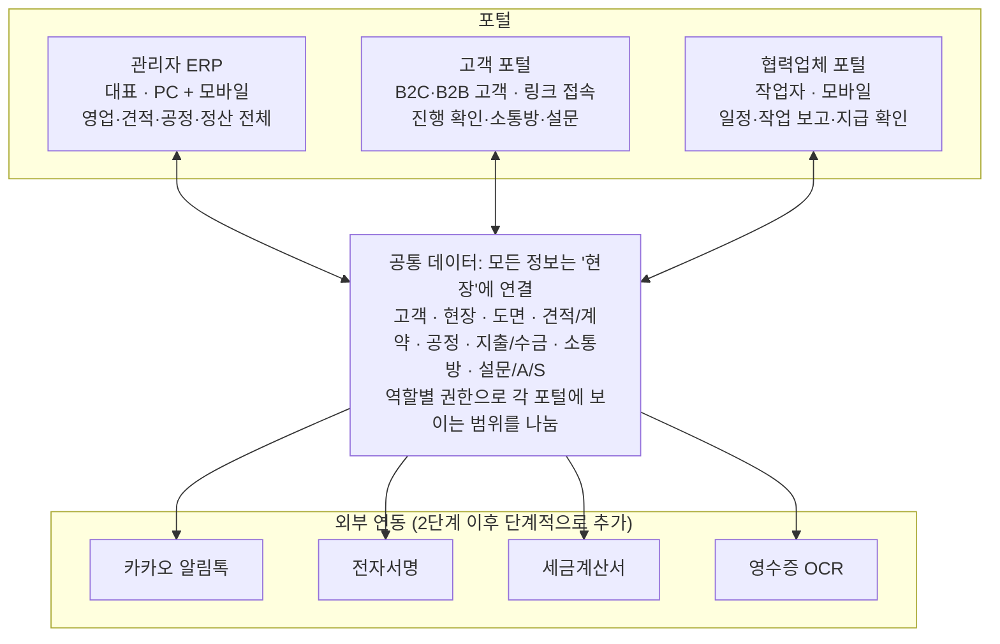
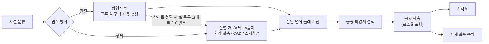

# 인테리어 1인 기업 통합 ERP 플랫폼 기획서

작성일: 2026-10-16 · 작성자: Hongcle

## 1. 개요

대표 1인이 문의 접수부터 A/S·후기까지 인테리어 현장 전체를 한 화면에서 처리하고, 고객과 협력업체는 각자의 포털에서 같은 데이터를 보는 웹·모바일 통합 플랫폼을 만든다.

**해결하려는 문제**

- 견적은 엑셀, 일정은 달력, 사진은 카톡, 정산은 통장 메모로 흩어져 있어 현장별 손익을 바로 알 수 없다.
- 고객 연락(진행 상황, 사진, 변경 요청)이 개인 카톡에 섞여 기록이 남지 않는다.
- 협력업체(목공, 전기, 설비, 타일, 도장 등) 일정 조율과 인건비 정산을 전부 대표가 기억에 의존한다.

**목표**

1. 현장 하나의 모든 정보(고객, 도면, 견적, 공정, 비용, 대화)를 한 곳에 묶는다.
2. 현장에서 휴대폰으로 사진·지출·작업 완료를 30초 안에 입력한다.
3. 고객이 진행 상황을 스스로 확인하고, 공사 후 만족도 조사로 의견을 남긴다.
4. B2C(개인 주거)와 B2B(상업공간, 사무실, 건설사 하도급)를 같은 시스템에서 처리한다.

**사용자**

| 사용자 | 접속 | 주요 사용 |
| --- | --- | --- |
| 대표(관리자) | PC + 모바일 | 모든 업무, 견적·계약·정산 |
| B2C 고객 (개인 주거) | 모바일 중심 | 견적·계약 확인, 공정 사진, 소통방, 결제 안내, 만족도 조사 |
| B2B 고객 (상가·사무실·건설사) | PC 중심 | 견적 비교, 세금계산서, 기성 청구, 담당자 여럿 |
| 협력업체·작업자 | 모바일 | 배정 일정 확인, 작업 완료·사진 등록, 대금 확인 |

## 2. 서비스 구조

하나의 시스템 안에 관리자·고객·협력업체 세 포털을 두고, 같은 현장 데이터를 권한에 따라 다르게 보여준다.

B2C와 B2B는 별도 시스템이 아니라 고객 유형으로 구분한다. B2C는 가족 단위 소통과 단계별 결제가, B2B는 담당자 여러 명·세금계산서·기성 청구·견적 비교가 중심이다.

## 3. 핵심 업무 흐름

한 현장은 문의부터 후기까지 10단계를 거치며, 시스템은 각 단계에서 다음 단계에 필요한 문서를 자동으로 넘긴다.

> 고객 소통방: 계약부터 A/S까지 현장별 하나의 대화방

견적에서 고객이 수정을 요청하면 도면으로 돌아가 새 버전을 만든다. 계약을 기점으로 영업에서 시공·사후관리로 넘어가며, 확정 견적은 계약서·발주 목록·공정표·수금 일정을 한 번에 만든다.

## 4. 기능 명세

모든 모듈은 '현장(프로젝트)'을 중심으로 연결되며, 아래 9개 모듈을 MVP 범위로 둔다.

### 4.1 고객·상담 관리 (CRM)

- 문의 접수: 홈페이지 폼, 전화, 네이버/인스타/숨고 등 유입 경로 기록
- 고객 카드: 연락처, 주소, 평수, 예산, 희망 일정, 선호 스타일, 상담 메모, 첨부 사진
- 영업 단계 칸반: 문의 → 상담 → 실측 → 견적 발송 → 계약 / 실패(사유 기록)
- B2B 고객은 회사 단위 + 담당자 여러 명, 사업자번호·세금계산서 정보 보관
- 재문의 알림: 견적 발송 후 N일 무응답 시 팔로업 알림

### 4.2 견적서·물량 산출·계약서

견적은 시설 분류 → 실(공간) 치수 → 공종별 물량 → 자재 환산 → 발주 수량 순서로 한 번에 이어진다. 치수를 한 번 입력하면 견적서와 자재 발주 수량이 같은 데이터에서 나온다.

#### 4.2.1 시설 분류

| 대분류 | 세부 유형 | 기본 실 구성 (예) |
| --- | --- | --- |
| 아파트 | 평형별 (24·32·43평형 등), 판상형·타워형 | 거실, 주방, 안방, 작은방 1~2, 욕실 1~2, 현관, 발코니 |
| 주택 | 단독, 다가구, 타운하우스 | 아파트 구성 + 계단실, 다락, 층별 구분 |
| 상업공간 | 카페·음식점, 상가, 학원, 병원 | 홀, 주방, 화장실, 창고, 카운터 |
| 사무실 | 일반 사무실, 공유오피스 | 업무공간, 회의실, 대표실, 탕비실 |

- 대분류·세부 유형·기본 실 구성은 관리자가 추가·수정할 수 있다.
- 시설 분류는 견적 템플릿, 단가 등급, 공종 기본값(예: 상업공간은 소방·간판 공종 표시)을 정하는 기준이 된다.

#### 4.2.2 간편 견적 (평형 기반)

- 입력: 시설 유형 + 평형(공급/전용) + 마감 등급(기본/중급/고급) + 공사 범위(전체 / 도배·바닥만 등 부분)
- 평형별 표준 템플릿에서 실 목록과 표준 치수(가로·세로·천장고)를 자동 생성한다.
- 즉시 개략 견적을 만들어 상담 단계에서 예산 범위 안내에 쓴다.
- 상세 견적으로 전환하면 실 목록을 그대로 이어받고 실측 치수만 고친다.
- 표준 템플릿 치수와 단가는 대표가 실제 시공 데이터로 입력·보정한다. 완료 현장이 쌓일수록 정확해진다.

#### 4.2.3 상세 견적 (실별 치수 기반)

- 실마다 가로 × 세로 × 천장고(m)를 입력한다. ㄱ자처럼 직사각형이 아닌 실은 구역을 나눠 합산한다.
- 개구부(문·창문·붙박이장)는 폭 × 높이 × 개수로 입력해 벽 면적에서 뺀다.
- 입력 경로는 세 가지다: 현장 실측(모바일에서 레이저 거리측정기 값 입력), CAD 도면 치수, 스케치업 모델 치수.
- 실마다 공종·마감재를 고른다(예: 안방 = 실크벽지 + 강마루 + 천장 몰딩).

치수에서 자동 계산되는 값:

| 계산 값 | 공식 | 쓰이는 공종 |
| --- | --- | --- |
| 바닥 면적 | 가로 × 세로 | 바닥재, 바닥 타일, 방수, 난방 |
| 천장 면적 | 가로 × 세로 | 천장 도배·도장, 천장재 |
| 둘레 | 2 × (가로 + 세로) | 걸레받이, 천장 몰딩 |
| 벽 면적 | 둘레 × 천장고 − 개구부 면적 | 도배, 도장, 벽 타일 |
| 걸레받이 길이 | 둘레 − 문 폭 합계 | 걸레받이 |

#### 4.2.4 물량 산출과 발주 수량

- **자재 마스터**: 자재별 규격, 포장 단위, 로스율, 거래처, 단가를 등록한다.
- **공종 레시피**: 마감재 하나를 고르면 부자재까지 함께 산출한다. 예: 도배 1㎡ = 벽지 + 초배지 + 풀, 타일 1㎡ = 타일 + 접착제 + 줄눈재.
- **소요량** = 면적(또는 길이) × (1 + 로스율)
- **발주 수량** = 소요량 ÷ 포장 단위, 올림
- **현장 합산 후 올림**: 같은 자재는 실별 소요량을 먼저 합친 뒤 올림한다. 실마다 올림하면 과다 발주가 생긴다.
- 발주 수량은 거래처별 발주서로 묶여 4.5 자재 발주로 넘어가고, 입고 후 남은 자재를 기록해 다음 현장에 쓴다.
- 견적서 출력은 둘로 나눈다. 고객용은 실별·공종별 금액, 내부용은 물량·원가·마진이다.

계산 예시 (자재 규격과 로스율은 예시값이며, 실제 값은 자재 마스터에 등록한 값을 쓴다):

| 항목 | 계산 | 결과 |
| --- | --- | --- |
| 안방 치수 | 3.6m × 4.2m × 천장고 2.3m, 문 1 (0.9×2.1), 창 1 (2.4×1.5) | |
| 둘레 | 2 × (3.6 + 4.2) | 15.6m |
| 벽 면적 | 15.6 × 2.3 − 1.89 − 3.6 | 30.39㎡ |
| 천장 면적 | 3.6 × 4.2 | 15.12㎡ |
| 벽지 (벽+천장, 로스 15%, 1롤 16.5㎡) | (30.39 + 15.12) × 1.15 ÷ 16.5 = 3.17 | 4롤 |
| 강마루 (로스 5%, 1박스 2.0㎡) | 15.12 × 1.05 ÷ 2.0 = 7.94 | 8박스 |
| 걸레받이 (로스 10%, 1본 2.4m) | (15.6 − 0.9) × 1.1 ÷ 2.4 = 6.74 | 7본 |

#### 4.2.5 CAD·스케치업 연동 (단계적)

| 단계 | 방식 | 비고 |
| --- | --- | --- |
| 1단계 | 도면 PDF·이미지, DWG·SKP 파일을 현장에 첨부하고 도면을 보며 실별 치수를 직접 입력 | 개발 부담 없음 |
| 3단계 | CAD에서 DXF로 저장해 올리면 실(닫힌 폴리라인)별 면적·둘레를 자동 추출하고, 레이어 이름으로 실 구분 | DWG는 직접 읽기 어려워 DXF 저장을 권장 |
| 4단계 | 스케치업 확장 프로그램(Ruby)으로 그룹·태그별 바닥·벽 면적을 CSV/JSON으로 내보내 가져오기 | 실 이름 붙이는 규칙을 먼저 정함 |

#### 4.2.6 견적 관리·계약서

- 단가표: 공종(철거, 목공, 전기, 설비, 타일, 도장, 도배, 바닥, 가구 등) × 품목 × 단위 × 자재비·인건비 단가
- 원가·마진 자동 계산: 고객용(판매가)과 내부용(원가, 이익률) 화면 분리
- 버전 관리: 1차·2차 수정 견적 비교, 고객이 포털에서 승인
- 계약서: 확정 견적에서 자동 생성(공사 기간, 결제 조건, 하자보수 기간), 전자서명, PDF 발급

### 4.3 도면·렌더링

- 현장별 파일함: 실측도, 평면도, 전개도, 3D 렌더링 이미지, 마감재 보드
- 버전별 업로드와 고객 피드백: 이미지 위 특정 위치에 핀 댓글 ("여기 조명 더 밝게")
- 고객 승인 상태 표시(검토 중 / 수정 요청 / 확정)
- 도면 작성 자체는 기존 툴(스케치업, 오토캐드, 플래너 5D 등)을 쓰고 결과물만 올리는 방식

### 4.4 공정·일정 관리

- 공정표(간트): 공종별 시작·종료일, 선후 관계(예: 설비 후 타일)
- 협력업체 배정: 공정마다 업체·작업자 지정, 배정 시 카카오 알림톡/문자 발송
- 통합 캘린더: 여러 현장을 한 달력에 표시, 같은 작업자 중복 배정 경고
- 현장 일지: 날짜별 사진 + 한 줄 메모, 고객 공개 여부 선택
- 체크리스트: 관리사무소 공사 신고, 이웃 동의서, 엘리베이터 예약, 폐기물 처리

### 4.5 자재·비용·수금 정산

- 자재 발주: 4.2.4에서 산출한 발주 수량으로 거래처별 발주서 자동 생성, 입고 확인, 잔여 자재 기록
- 지출 입력: 모바일에서 영수증 촬영 → 금액·거래처 자동 인식(OCR), 현장에 연결
- 인건비: 작업자별 일당·도급 금액, 지급 여부, 3.3% 원천징수 계산
- 수금: 계약금 / 중도금 / 잔금 일정과 입금 확인, 미수금 알림
- 현장별 손익: 계약금액 − (자재비 + 인건비 + 경비) = 실제 이익, 견적 당시 예상 이익과 비교
- 세무: 세금계산서·현금영수증 발행 기록, 부가세 신고용 매출·매입 엑셀 내보내기

### 4.6 협력업체 리스트

- 업체 카드: 공종, 연락처, 계좌, 단가, 활동 지역, 사업자 여부
- 작업 이력과 내부 평가(품질, 일정 준수, 하자 발생), 미지급액 조회
- 협력업체 포털: 본인 배정 일정 확인, 작업 완료 사진 등록, 지급 예정일 확인

### 4.7 고객 소통방 (단체톡 대체)

- 현장마다 하나의 대화방: 대표 + 고객(가족 여러 명) + 필요시 협력업체 초대
- 메시지·사진·파일, 중요 메시지 고정(예: 자재 확정 사항)
- 변경 요청을 대화에서 바로 '추가 공사' 항목으로 전환 → 견적에 반영
- 새 메시지는 카카오 알림톡으로 알림 (고객이 앱을 따로 설치하지 않아도 됨)
- 대화 기록이 계약 분쟁 시 증빙으로 남음

### 4.8 고객 포털·의견 조사

- 로그인 없이 문자 링크(매직링크)로 접속, 내 현장 진행률·사진·결제 일정 확인
- 단계별 설문: 상담 후(응대 만족도), 공사 중간(소통·청결), 완공 후(품질·추천 의향 NPS)
- 대시보드에 평균 점수·불만 키워드 집계, 고객 동의 시 후기를 홈페이지에 게시
- A/S 접수: 사진 첨부, 하자보수 기간 자동 판별

### 4.9 대표 대시보드

- 오늘 할 일: 상담·실측 예약, 작업 일정, 수금 예정, 미답변 메시지
- 월별 수주액·매출·이익, 견적 대비 계약 전환율, 유입 경로별 성과

## 5. 데이터 모델

모든 데이터는 '현장(Project)'에 매달리며, 고객과 협력업체는 현장을 통해 연결된다.

| 엔티티 | 주요 필드 | 관계 |
| --- | --- | --- |
| 고객 (Customer) | 유형(B2C/B2B), 이름·회사명, 연락처, 사업자번호, 유입 경로 | 1 : N 현장, 1 : N 담당자 |
| 담당자 (Contact) | 이름, 역할, 연락처 | N : 1 고객 (B2B 또는 가족 구성원) |
| 시설 유형 (FacilityType) | 대분류, 세부 유형, 기본 실 구성 | 1 : N 현장, 1 : N 평형 템플릿 |
| 평형 템플릿 (SizeTemplate) | 평형(공급/전용), 표준 실 목록·치수 | N : 1 시설 유형 |
| 현장 (Project) | 주소, 시설 유형, 평형, 영업 단계, 공사 기간, 상태 | 중심 엔티티 |
| 실 (Room) | 실 이름, 가로, 세로, 천장고, 구역 분할, 치수 출처(실측/CAD/스케치업/템플릿) | N : 1 현장, 1 : N 개구부 |
| 개구부 (Opening) | 종류(문/창/붙박이장), 폭, 높이, 개수 | N : 1 실 |
| 자재 (Material) | 품명, 규격, 포장 단위, 로스율, 거래처, 단가 | 레시피·물량이 참조 |
| 공종 레시피 (Recipe) | 마감재, 기준 단위(㎡/m/개), 부자재별 소요량 | N : N 자재 |
| 물량 (QuantityLine) | 실, 자재, 산출 기준 값, 소요량, 발주 수량 | N : 1 견적, N : 1 실 |
| 발주 (PurchaseOrder) | 거래처, 품목·수량, 발주일, 입고 상태 | N : 1 현장 |
| 상담 기록 (Consultation) | 일시, 방식, 내용, 다음 액션 | N : 1 현장 |
| 도면·파일 (Drawing) | 종류, 버전, 승인 상태, 핀 댓글 | N : 1 현장 |
| 단가 항목 (PriceItem) | 공종, 품명, 규격, 단위, 자재 단가, 인건비 단가 | 견적 항목이 참조 |
| 견적 (Estimate) | 버전, 합계, 할인, 부가세, 예상 원가, 상태 | N : 1 현장, 1 : N 견적 항목 |
| 계약 (Contract) | 계약금액, 결제 조건, 서명일, PDF | 1 : 1 확정 견적 |
| 공정 (Task) | 공종, 시작·종료일, 선행 공정, 진행률 | N : 1 현장, N : 1 협력업체 |
| 협력업체 (Partner) | 공종, 연락처, 계좌, 단가, 평가 | 1 : N 공정, 1 : N 지출 |
| 지출 (Expense) | 분류(자재/인건/경비), 금액, 증빙, 지급 여부 | N : 1 현장 |
| 수금 (Payment) | 차수(계약금/중도금/잔금), 예정일, 입금일, 금액 | N : 1 계약 |
| 대화방·메시지 (Chat) | 참여자, 본문, 첨부, 고정 여부 | 1 : 1 현장 |
| 설문 응답 (Survey) | 단계, 점수, 의견, 후기 게시 동의 | N : 1 현장 |
| A/S 접수 (Warranty) | 내용, 사진, 보수 기간 내 여부, 처리 상태 | N : 1 현장 |

## 6. 화면 구성

관리자 17개, 고객 6개, 협력업체 3개 화면으로 시작하며, 모두 모바일 화면에 맞게 반응형으로 만든다.

| 구분 | 화면 | 핵심 내용 |
| --- | --- | --- |
| 관리자 | 대시보드 | 오늘 일정, 미수금, 미답변, 월 실적 |
| 관리자 | 영업 칸반 | 문의~계약 단계별 카드 드래그 |
| 관리자 | 고객 목록·상세 | 고객 카드, 현장 이력, 상담 기록 |
| 관리자 | 현장 상세 (허브) | 탭: 개요 · 도면 · 견적 · 공정 · 비용 · 수금 · 소통방 · 설문 |
| 관리자 | 견적 시작 | 시설 분류 선택 → 간편(평형) / 상세(실별 치수) 방식 선택 |
| 관리자 | 실별 치수 입력 | 실 추가·구역 분할, 가로·세로·천장고, 개구부, 도면 나란히 보기 |
| 관리자 | 견적 편집기 | 실별 마감재 선택, 단가표 검색, 마진 표시, PDF 미리보기 |
| 관리자 | 물량 산출표 | 실별·자재별 소요량, 현장 합산, 발주 수량, 발주서 생성 |
| 관리자 | 자재 마스터·레시피 | 자재 규격·포장 단위·로스율, 공종별 부자재 구성 |
| 관리자 | 평형 템플릿 | 시설 유형·평형별 표준 실 구성과 치수 |
| 관리자 | 계약서 | 템플릿, 전자서명 요청 |
| 관리자 | 통합 캘린더·간트 | 전 현장 일정, 작업자 중복 경고 |
| 관리자 | 협력업체 목록 | 공종 필터, 평가, 미지급액 |
| 관리자 | 단가표 관리 | 공종·품목 등록, 템플릿 |
| 관리자 | 정산·손익 | 현장별/월별 손익, 세무 내보내기 |
| 관리자 | 설문·후기 | 점수 추이, 불만 항목, 후기 게시 관리 |
| 관리자 (모바일) | 빠른 입력 | 사진 일지, 영수증 촬영, 작업 완료 버튼 |
| 관리자 (모바일) | 현장 실측 | 실별 가로·세로·높이·개구부 입력, 실측 사진 첨부 |
| 고객 | 내 현장 홈 | 진행률, 다음 일정, 최근 사진 |
| 고객 | 도면·렌더링 | 보기, 핀 댓글, 승인 |
| 고객 | 견적·계약 | 버전 비교, 승인, 서명 |
| 고객 | 소통방 | 대표·가족·협력업체와 대화 |
| 고객 | 결제 일정 | 차수별 금액, 입금 계좌, 영수증 |
| 고객 | 설문·A/S | 단계별 설문, A/S 접수 |
| 협력업체 | 내 일정 | 배정된 현장·날짜·주소 |
| 협력업체 | 작업 보고 | 완료 사진, 특이사항 |
| 협력업체 | 지급 내역 | 지급 예정·완료 |

## 7. 권장 기술 구성과 비용

하나의 웹앱(반응형 + 홈 화면 설치형 PWA)으로 관리자·고객·협력업체 화면을 모두 만들고, 초기 운영비는 월 0~10만 원 수준으로 잡는다. 아래 금액은 최신 요금표를 확인하지 않은 대략치이며 개발 착수 전 재확인이 필요하다.

| 영역 | 권장 | 선택 이유 | 비용 (대략) |
| --- | --- | --- | --- |
| 화면·서버 | Next.js (TypeScript) | 관리자·고객·협력업체 포털을 한 코드에서 권한으로 분리 | 무료 |
| 호스팅 | Vercel | 배포 자동화, 소규모는 무료 티어로 충분 | 무료~월 약 3만 원 |
| DB·로그인·파일 | Supabase (PostgreSQL) | 권한(RLS), 사진·도면 저장, 실시간 채팅까지 한 번에 | 무료~월 약 3.5만 원 |
| 알림 | 카카오 알림톡 (발송 대행사) | 고객이 앱 설치 없이 링크로 접속 | 건당 약 10원 내외 |
| 전자서명 | 자체 서명 패드 → 필요시 모두싸인 등 연동 | 초기엔 서명 이미지 + PDF로 충분 | 무료~유료 |
| 세금계산서 | 초기엔 홈택스 수기 발행 + 기록, 나중에 팝빌 등 API | 건수가 적을 때 연동 비용이 더 큼 | 건당 수백 원 (API 사용 시) |
| 영수증 인식 | AI 비전 API (OCR) | 사진 한 장으로 금액·거래처 입력 | 장당 수 원 |
| 도메인 | .com / .co.kr | 브랜드 홈페이지 겸용 | 연 약 2만 원 |

- **대안 1 (Python)**: Django + PostgreSQL. 관리자 화면을 빨리 만들 수 있지만 고객용 모바일 화면·채팅은 추가 작업이 더 크다.
- **대안 2 (노코드)**: Notion/Airtable + Softr 등. 가장 빠르지만 견적 계산·권한 분리·B2B 확장에서 한계가 빨리 온다.

## 8. 단계별 로드맵

요청하신 MVP 기능을 4단계로 나눠, 대표가 매일 쓰는 내부 운영부터 만들고 고객·협력업체·B2B 순으로 연다.

| 단계 | 범위 | 다음 단계로 넘어가는 기준 |
| --- | --- | --- |
| 1단계 · 내부 운영 | 고객·상담 관리, 시설 분류·평형 간편 견적, 실별 치수 상세 견적, 자재 마스터·물량 산출·발주 수량, 계약서, 현장 허브·공정표, 협력업체 리스트, 지출·수금·손익 | 현장 1건에 실사용 |
| 2단계 · 고객 포털 | 링크 접속 고객 화면, 고객 소통방, 도면 핀 댓글·승인, 단계별 설문, 카카오 알림톡 | 고객이 포털로 소통 |
| 3단계 · 현장 효율 | 협력업체 포털, 영수증 OCR, 전자서명 연동, 거래처 발주서 발송, DXF 치수 자동 추출, A/S 접수 | 현장 입력을 폰으로 완결 |
| 4단계 · B2B·확장 | 회사·담당자 관리, 세금계산서 API, 기성 청구, 스케치업 치수 연동, 공개 홈페이지·후기, 온라인 견적 문의 | B2B 고객 1곳 적용 |

1인 개발(Claude와 함께) 기준 단계당 4~8주를 예상하며, 실제 기간은 개발 방식을 정한 뒤 다시 잡는다.

## 9. 리스크와 결정 필요 사항

가장 큰 리스크는 기능을 한꺼번에 만들다 실제 현장에 쓰기 전에 지치는 것이므로, 1단계를 다음 현장에 바로 적용하는 것을 기준으로 삼는다.

**리스크**

| 리스크 | 대응 |
| --- | --- |
| 범위가 너무 커서 완성이 늦어짐 | 단계별 출시, 현장 1건에 실제 적용하며 개선 |
| 고객이 카톡을 두고 새 소통방을 안 씀 | 알림톡 링크로 바로 접속, 앱 설치·회원가입 없음, 계약서에 공식 채널로 명시 |
| 개인정보(주소·연락처·도면) 유출 | 역할별 접근 권한, 매직링크 만료, 개인정보 처리방침 게시 |
| 데이터 입력이 귀찮아 다시 엑셀로 돌아감 | 모바일 빠른 입력, 영수증 OCR, 기존 엑셀 단가표·고객 목록 일괄 가져오기 |
| 전자계약·세무 법적 요건 | 표준 계약서 양식 검토, 세무사와 내보내기 형식 확인 |

**결정이 필요한 사항**

- [ ] 개발 방식: 직접 개발(Claude와 함께) / 외주 / 노코드
- [ ] 현재 쓰는 견적서·단가표 엑셀 양식 공유 (견적 모듈 설계 기준)
- [ ] B2B 고객의 주 유형: 상가·사무실 직거래인지, 건설사·분양사 하도급인지
- [ ] B2B를 같은 시스템 안의 고객 유형으로 둘지, 전용 화면을 따로 둘지
- [ ] 고객용 공개 홈페이지(포트폴리오·상담 신청)를 1단계에 포함할지
- [ ] 서비스 이름과 도메인
- [ ] 평형별 표준 실 구성·치수 데이터 (자주 하는 평형부터, 기존 실측 자료 활용)
- [ ] 자재별 포장 단위와 로스율 기준 (현재 쓰는 값)
- [ ] 사용 중인 CAD 프로그램·버전과 스케치업 버전, 도면에서 실 이름·레이어를 붙이는 방식
